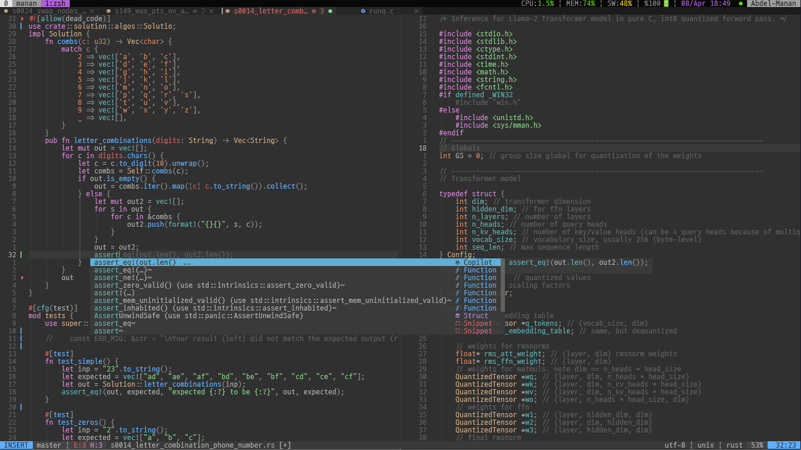
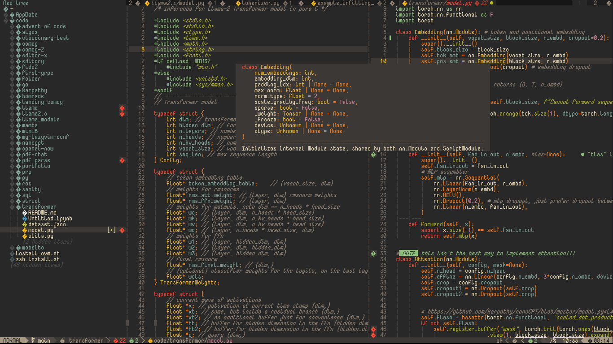

<h2 align="center"> MY NEOVIM CONFIG</h2>

This is built with __Neovim, LazyVim, Mason__, and other awesome plugins.

### with TMUX

## Agent workflow

Codex CLI must be available on `PATH`. Sidekick uses tmux to keep its agent
terminal session alive and reloads files changed by the agent. Copilot inline
completion is retained; Sidekick next-edit suggestions are disabled.

| Keys | Action |
| --- | --- |
| `Space aa` | Toggle Codex through Sidekick (normal or visual mode) |
| `Space af` | Send the current file context to Codex |
| `Space av` | Send the visual selection to Codex |
| `Space ae` | Send diagnostics to Codex |
| `Space ar` | Open Diffview to review working-tree changes |
| `Space aR` | Close Diffview |
| `Space ah` | Show the current file's Git history |
| `Space ac` | Toggle Copilot Chat |

Restart Neovim after updating the configuration. Use `:checkhealth sidekick`
for CLI and multiplexer diagnostics. Context mappings prepare agent input;
review and submit it in the agent terminal.
